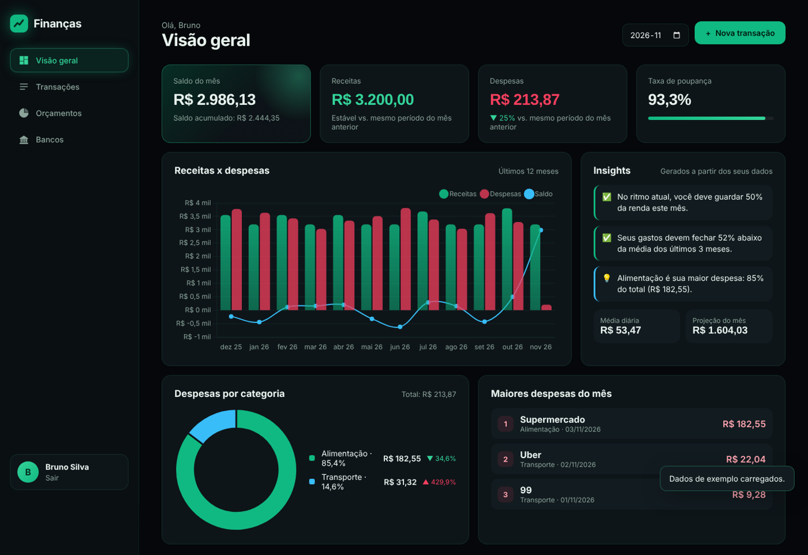
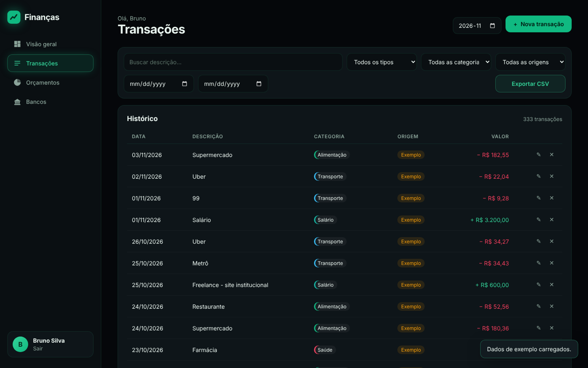
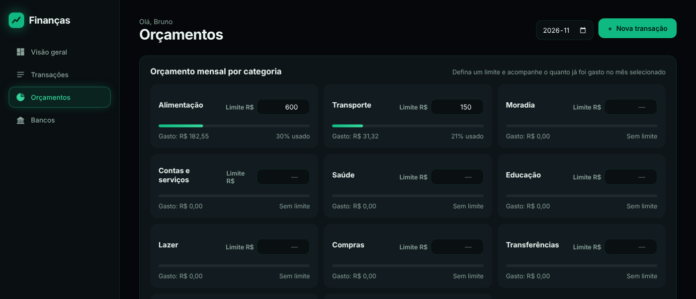
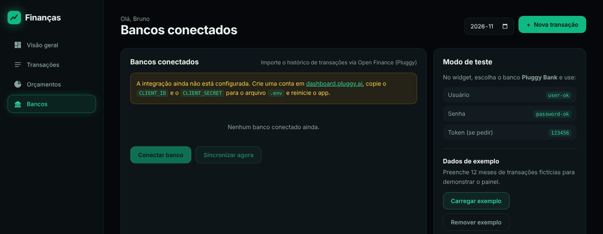
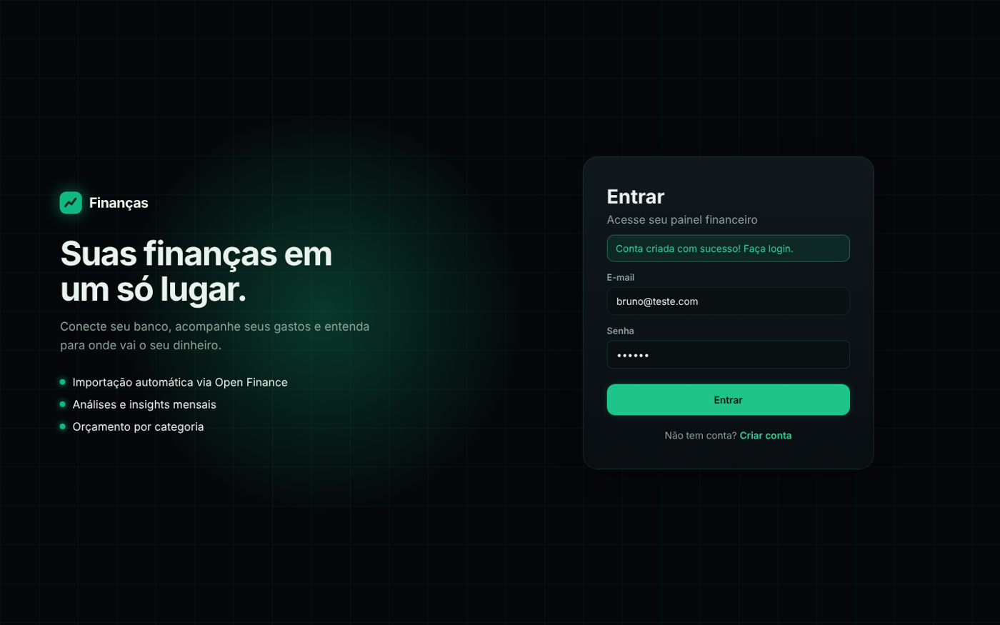

# 💰 Gerenciador de Finanças 2.0

Aplicação web Full Stack para controle financeiro pessoal, com **integração Open Finance** para importar o histórico de transações direto do banco, **análises automáticas** e **orçamento por categoria**.

🔗 **Demo online:** [gerenciador-financas-v9hh.onrender.com](https://gerenciador-financas-v9hh.onrender.com). Clique em **Entrar como visitante** para ver o painel com dados de exemplo.

> Hospedado no plano gratuito do Render: o primeiro acesso pode levar cerca de 1 minuto para "acordar" o servidor.



## ✨ Funcionalidades

**Open Finance (Pluggy)**
- Conexão com bancos pelo widget oficial da Pluggy
- Importação automática do histórico (padrão: últimos 12 meses), com paginação por cursor
- Sincronização sem duplicar transações (chave única por transação do banco)
- Conversão das categorias do banco para as categorias do app

**Análises**
- Indicadores do mês: saldo, receitas, despesas e taxa de poupança
- Comparação com o mês anterior (no mês atual, compara o **mesmo período**, dia 1 até hoje)
- Gráfico de receitas, despesas e saldo dos últimos 12 meses
- Despesas por categoria, com variação em relação ao mês anterior
- Média de gasto diário e **projeção de gasto** até o fim do mês
- **Insights automáticos**: alerta de gastos acima da média, categoria que mais subiu, orçamento estourado
- Ranking das maiores despesas

**Gestão**
- Cadastro e login com senha criptografada (hash)
- Criar, editar e excluir transações
- Filtros por texto, tipo, categoria, origem e período
- Orçamento mensal por categoria, com barras de progresso
- Exportação para CSV (abre direto no Excel)
- Dados de exemplo para demonstração
- Layout responsivo (computador e celular)

## 📸 Telas

| Transações | Orçamentos |
|---|---|
|  |  |

| Bancos (Open Finance) | Login |
|---|---|
|  |  |

## 🛠️ Tecnologias

| Camada | Tecnologias |
|---|---|
| Back-end | Python, Flask, Requests |
| Banco de dados | SQLite (com migração automática) |
| Front-end | HTML, CSS, JavaScript (Fetch API) |
| Gráficos | Chart.js |
| Integração | Pluggy API (Open Finance) |

## 🏗️ Arquitetura

```
app.py        → rotas das páginas e da API REST
analises.py   → cálculos de indicadores, séries e insights
pluggy.py     → cliente da API da Pluggy e conversão das transações
database.py   → criação e migração das tabelas
exemplo.py    → gerador de dados de demonstração
```

As credenciais da Pluggy ficam **só no servidor**. O navegador recebe apenas um *connect token* temporário, como recomenda a documentação oficial.

| Método | Rota | Descrição |
|---|---|---|
| GET | `/api/resumo?mes=AAAA-MM` | Indicadores, séries, categorias e insights |
| GET | `/api/transacoes` | Lista com filtros |
| POST / PUT / DELETE | `/api/transacoes[/<id>]` | Criar, editar e excluir |
| PUT | `/api/orcamentos` | Definir limite por categoria |
| GET | `/api/exportar.csv` | Exportar para CSV |
| POST | `/api/pluggy/token` | Gera o connect token do widget |
| POST | `/api/pluggy/conexoes` | Importa o histórico de um banco conectado |
| POST | `/api/pluggy/sincronizar` | Atualiza todos os bancos conectados |

## 🚀 Como rodar

```bash
git clone https://github.com/Silvaxzy/gerenciador-financas.git
cd gerenciador-financas

python -m venv venv
venv\Scripts\activate        # Windows
source venv/bin/activate     # Linux/Mac

pip install -r requirements.txt
```

Copie o arquivo `.env.example` para `.env` e preencha:

```
SECRET_KEY=uma-frase-secreta-longa
PLUGGY_CLIENT_ID=seu-client-id
PLUGGY_CLIENT_SECRET=seu-client-secret
```

As credenciais da Pluggy são obtidas em [dashboard.pluggy.ai](https://dashboard.pluggy.ai). Sem elas, o app funciona normalmente, só sem a importação bancária.

```bash
python app.py
```

Acesse **http://127.0.0.1:5000**.

### Testando o Open Finance

Na aba **Bancos**, clique em **Conectar banco**, escolha o **Pluggy Bank** (banco de testes) e entre com:

- Usuário: `user-ok`
- Senha: `password-ok`

### Deploy

O projeto roda no [Render](https://render.com) com o servidor de produção **Gunicorn**:

- **Build:** `pip install -r requirements.txt`
- **Start:** `gunicorn app:app`
- **Variáveis:** `SECRET_KEY` e `DEMO=1`. O modo demo mostra o botão de visitante e mantém a conexão bancária desativada.

## 📌 Próximas melhorias

- [ ] Metas de economia
- [ ] Importação de extrato em OFX
- [ ] Webhooks da Pluggy para sincronização automática
- [x] Deploy online

## 👤 Autor

Feito por **Bruno Silva**, estudante de Análise e Desenvolvimento de Sistemas.

[GitHub](https://github.com/Silvaxzy) · [LinkedIn](https://www.linkedin.com/in/bruno-silva-2846192aa) · [Portfólio](https://silvaxzy.github.io)
